  

# AI Skills for Networks

This repository contains AI-agent skills for blockchain network operations.
They are maintained by POSTHUMAN, but the skills are intended to be usable by
any validator operator with their own inventory and runbooks.

Each network directory is a self-contained skill for its supported roles:
validators, full and RPC nodes, indexers, miners, or network-specific sidecars.
Coverage varies by skill; follow its documented scope and safety gates.

The repository also includes generic operational skills and a read-only
[MCP catalog server](mcp-server/README.md). The MCP serves only this public
repository; it never reads an operator's inventory or private knowledge base.

Network skills should avoid real operator infrastructure data. Use fake example
inventories and machine-readable schemas when a skill needs host, service, RPC,
valoper, or consensus-address input.

## Skills

The repository contains **32 skills: 24 network-specific skills and 8 generic
operations skills**. Every published `SKILL.md` is linked below.

| Browse | Coverage |
| --- | --- |
| [Network skills](#network-skills) | Validators, full/RPC nodes, indexers, miners, and sidecars across 24 network-specific packages |
| [Generic operations](#generic-operations) | Onboarding, upgrades, incidents, migration, snapshots, exit, service maintenance, and port audits |
| [Machine-readable catalog](catalog.json) | Skill IDs, installation slugs, categories, paths, and descriptions |
| [Read-only MCP server](mcp-server/README.md) | Programmatic skill discovery; metadata-only by default |

### Network Skills

- [AtomOne](atomone/SKILL.md) — AtomOne validator and full-node operations for
  `atomone-1` and reviewed testnets, including Photon fees/mint diagnostics,
  REStake/Authz, governance, upgrades, snapshots, incidents, and recovery.
- [Arc Network](arc/SKILL.md) — Arc follow-node operations with
  `arc-node-execution` and `arc-node-consensus`: snapshot-only bootstrap and the
  permanent `--el-profile` choice, relay-endpoint follow health and the frozen
  head that looks healthy, the `arc` RPC namespace, RPC exposure hardening, and
  hardforks that activate on a wall-clock timestamp rather than a block height.
- [Axelar](axelar/SKILL.md) — Axelar classic full-node/validator operations
  (`axelard`, `vald`, dedicated `tofnd`, broadcaster, and maintainers) plus the
  separate Amplifier verifier plane (`ampd`, dedicated `tofnd`, per-chain
  handlers/clients, onboarding review, and monitoring).
- [Base](base/SKILL.md) — Base OP Stack L2 node operations with
  `base-reth-node` and `base-consensus`: V2 snapshot restore, the permanent
  node-type and pruning choice, L1 derivation health and the frozen-safe-head
  failure, Flashblocks and historical proofs, RPC exposure hardening, and
  fork-deadline upgrades.
- [Bitcoin](bitcoin/SKILL.md) — Bitcoin Core full-node operations, pruning
  and assumeutxo, RPC and indexer backends, Lightning node operations for LND
  and Core Lightning, mining setup, monitoring, security hardening, upgrades,
  and backup and recovery.
- [Canton Network](canton/SKILL.md) — Canton Network validator operations on
  MainNet, TestNet and DevNet: Splice stack health, sync lag and automation
  triggers, scan API access, identities and database backups, disaster
  recovery, upgrades and migration IDs, and security hardening.
- [Celestia](celestia/SKILL.md) — Celestia consensus validator and full-node
  operations plus Fibre registration and Data Availability bridge/full/light
  node checks, including `celestia-appd`, `celestia-node`, public endpoints,
  snapshots, bridge-node sync, upgrades, and safe recovery.
- [Cosmos Hub](cosmoshub/SKILL.md) — Cosmos Hub Gaia validator and full-node
  operations for cosmoshub-4, including gaiad, CometBFT signing, provider
  security, IBC-facing checks, governance, upgrades, snapshots, and recovery.
- [Espresso](espresso/SKILL.md) — Espresso validator and query-node operations
  for Mainnet and Decaf, including consensus view liveness, participation
  scoring, cliquenet P2P triage, BLS/Schnorr/x25519 key custody, `staking-cli`
  registration and rotation on Ethereum, reward claims, storage pruning, and
  upgrades.
- [Ethereum](ethereum/SKILL.md) — Ethereum execution and consensus client
  operations for any client pair, checkpoint sync, validator creation,
  withdrawal credentials, exits and consolidations (EIP-7002/7251), slashing
  protection and key movement, MEV-Boost, monitoring, security hardening, and
  fork upgrades.
- [FastLane Sidecar](fastlane-sidecar/SKILL.md) — FastLane / shMonad MEV
  sidecar operations for Monad validators, including onboarding order,
  rootless Docker isolation, mempool IPC wiring, release verification,
  health checks, upgrades, and rollback.
- [FLOP Devnet](flop/SKILL.md) — FLOP GPU inference miner operations on the
  public devnet path: genesis, model and decode-policy preflight, sponsorship,
  vLLM backend and worker, session endpoint behind TLS or a tunnel,
  calibration, health checks, downtime budget, and safe retirement.
- [Fuel](fuel/SKILL.md) — Fuel Ignition fuel-core full-node and GraphQL
  operations plus Fuel Sequencer node, validator, sidecar, bridge, upgrade,
  snapshot, and Sway/forc workflows.
- [JunoClaw](junoclaw/SKILL.md) — Threshold-share validator onboarding,
  coordinated cutovers, certified state sync, and separate finality and seat
  participation checks, with on-demand runbooks, a synthetic inventory, report
  template, and safety evaluation scenarios.
- [Monad](monad/SKILL.md) — Monad validator and full-node operations for
  mainnet and testnet, including `monad-bft`, `monad-execution`,
  `monad-rpc`, TrieDB, OTel, staking, upgrades, and recovery checks.
- [NEAR](near/SKILL.md) — NEAR validator, RPC and archival node operations:
  `neard` health and sync, staking-pool creation and ping, epoch proposals,
  chunk production and endorsement, key custody, split-storage archival,
  monitoring, upgrades, and safe recovery.
- [Oraichain](oraichain/SKILL.md) — Oraichain oraid validator and node
  operations for mainnet, including RPC/API/gRPC checks, signing, upgrades,
  snapshot recovery, CosmWasm, oracle, VRF, OraiDEX/OBridge/OraiBTC, and
  OraichainEVM guardrails.
- [Osmosis](osmosis/SKILL.md) — Osmosis validator and full-node operations for
  `osmosis-1`, including RPC/API/gRPC checks, signing, upgrades, snapshots,
  IBC-facing validation, and safe recovery.
- [Provenance](provenance/SKILL.md) — Provenance Blockchain provenanced
  validator and full-node operations for pio-mainnet-1, including
  CometBFT/RPC/API/gRPC checks, signing, upgrades, governance, snapshots,
  application-module transaction guardrails, and recovery.
- [Shentu](shentu/SKILL.md) — Shentu Chain validator operations for
  `shentu-2.2`.
- [Solana](solana/SKILL.md) — Agave validator and RPC-node operations,
  including signing health, safe identity cutover, snapshots, upgrades,
  monitoring, SFDP checks, and incident triage.
- [Starknet](starknet/SKILL.md) — Starknet full-node, JSON-RPC,
  validator/staking/attestation, Cairo tooling, and Starkzap/app integration
  workflows.
- [The Graph](the-graph/SKILL.md) — Graph Protocol indexer operations under
  Graph Horizon: stack and deployment health, allocations and rules,
  GraphTally/TAP payments, POI staleness, rewards eligibility, delegation
  review, upgrades, and security gates.
- [XRPL EVM](xrplevm/SKILL.md) — XRPL EVM `exrpd` validator and full-node
  operations for `xrplevm_1440000-1`, including Proof of Authority admission,
  snapshot and state-sync bootstrap, app-hash agreement against independent
  RPCs, consensus-breaking versus patch upgrades, anti-double-sign discipline,
  the Cosmos and EVM API surfaces, monitoring, and hardening.

### Generic Operations

- [Nodes Service Maintenance](nodes-service-maintenance/SKILL.md) — Maintain
  node-service data, UI, contribution content, and deployments.
- [Server Node and Port Audit](server-node-port-audit/SKILL.md) — Identify
  blockchain workloads, listening ports, and effective network exposure.
- [Validator Exit and Decommission](validator-exit-decommission/SKILL.md) —
  Separate on-chain exit, unbonding, key retention, and infrastructure shutdown.
- [Validator Incident Response](validator-incident-response/SKILL.md) — Assess
  signing risk, preserve evidence, recover, and verify the result.
- [Validator Migration Cutover](validator-migration-cutover/SKILL.md) — Migrate
  workloads with anti-double-sign, cutover, and rollback gates.
- [Validator Onboarding](validator-onboarding/SKILL.md) — Prepare registration
  with readiness, key custody, parameter, transaction, and monitoring checks.
- [Validator Snapshot Recovery](validator-snapshot-recovery/SKILL.md) — Recover
  nodes with snapshot integrity, signer-state, and rollback checks.
- [Validator Upgrade](validator-upgrade/SKILL.md) — Plan and execute upgrades
  with migration, signing, and post-upgrade verification gates.

## Using a Skill

1. Select the network skill and read its full `SKILL.md` before acting. Check
   the supported network, environment, and role; for example, the FLOP package
   covers devnet miners, not validator activation or testnet deployment.
2. Supply your own private inventory and runbooks. Use the package's example
   inventory and schema where available; never commit production credentials.
3. Load referenced files and the relevant generic operations skill only when
   the task needs them. Review helper scripts before running them on a host.
4. Verify live state and required approvals. Loading a skill does not grant
   access, authorize transactions, or waive its safety gates.

## Keeping the Catalog Complete

When adding or renaming a skill, update its `SKILL.md`, the matching entry in
[`catalog.json`](catalog.json), and its link and description in this README in
one pull request. Update the counts above when the inventory changes. Check that
every published `SKILL.md` has exactly one catalog entry and one README listing,
and that all relative links resolve.

## Skill Package Layout

A mature network skill may include:

- `SKILL.md` — concise agent instructions and safety rules.
- `scripts/` — deterministic checks or helpers.
- `references/` — schemas or deeper reference material loaded only when needed.
- `examples/` — fake-value templates, never production inventory.
- `evals/` — scenario prompts for safety and behavior checks.

## Operating Principles

- Verify live state before acting.
- Prefer official project repositories and local operator inventory over stale
  assumptions.
- Do not perform destructive validator actions without explicit operator
  approval and key backups.
- Do not publish secrets, wallet mnemonics, keyring passwords, or private
  infrastructure credentials.

## License

This repository is licensed under MIT No Attribution (MIT-0). You may use,
copy, modify, redistribute, and adapt these skills, including for commercial
and internal validator operations, without attribution. Skills published on
ClawHub are distributed under the same MIT-0 terms.

See [LICENSE](LICENSE). Credits and the relicensing note (CC BY 4.0 to MIT-0 on
2026-11-12, with contributor agreement) are in [ATTRIBUTION.md](ATTRIBUTION.md).
